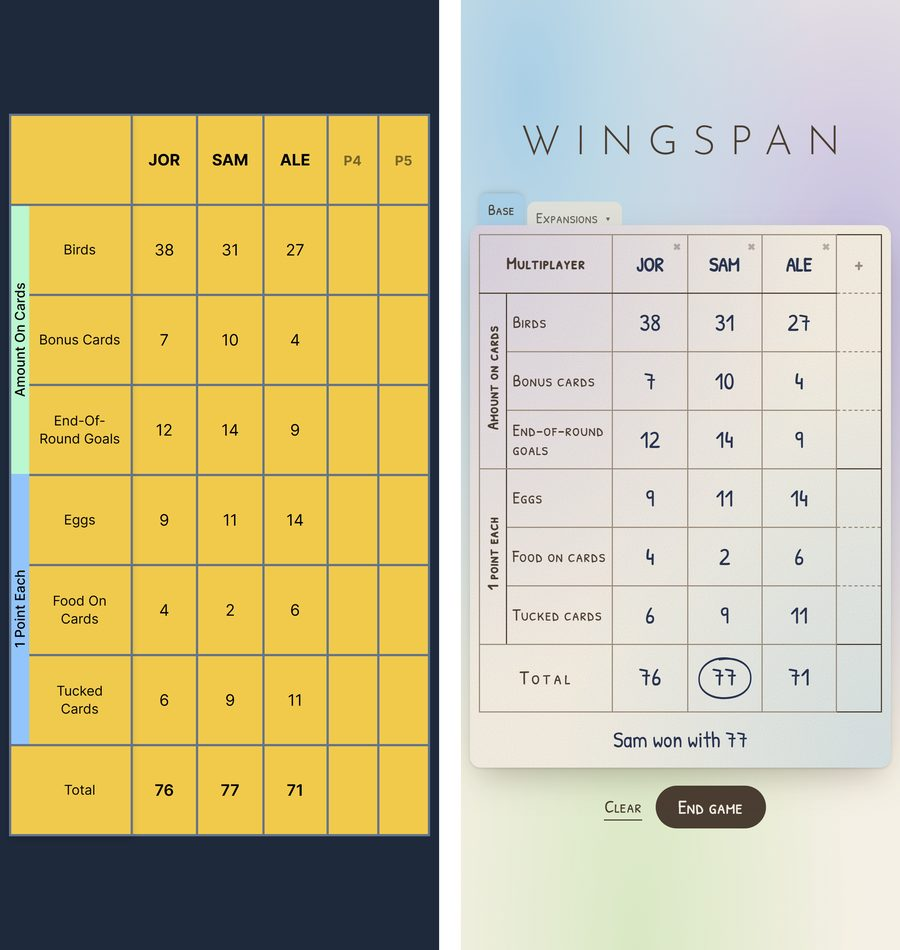

# Wingspan Score Sheet

A fan-made score sheet for the board game Wingspan. Players type their scores into a sheet that looks like the paper pad, and it adds them up, follows the expansion rules, names the winner and keeps past games.

**[Open the app](https://wingspanscoresheet.vercel.app/)**. It works in any browser, on a phone, a tablet or a computer, with nothing to install.

> Unofficial and fan-made. Not affiliated with or endorsed by Stonemaier Games, who publish Wingspan. No game art is used.



*The same game in the original version (left) and the redesign (right).*

## What it does

- **Every expansion, in any combination:** European, Oceania, Asia and Americas, with their extra scoring rows. Oceania's nectar is scored by majority in each habitat. Asia's Duet (2 players) and Flock (6–7 players) modes have their own rules. Americas' hummingbird scores can be negative.
- **The winner, by the rules:** the most points wins. A tie goes to whoever has the most unused food, and if that's tied too, the players share the win.
- **End game:** saves the game to Past games and starts a fresh sheet with the same players. Undo puts it back.
- **Past games:** open any game to see the full sheet, fix a score, delete it, or play again with the same players.
- **Kept between visits:** the sheet and past games save automatically in the browser, and the app says so if the browser won't let it save. Two open tabs stay in step, with checks against a stale question or a past-game edit undoing the other tab's changes.
- **Made for phones:** big touch targets, the number pad for scores, and five players fit on a 360px screen.
- **Each expansion's colours:** the page takes on the colours of the expansions in play, mixing them when there are several.

## Built with

Next.js 16 (App Router), React 19, TypeScript and Tailwind CSS 4. Scores and history live in the browser's local storage, so there's no server or account.

## Quality

- **Unit tests (Vitest)** cover the scoring rules: expansions, nectar majorities, tie-breaks and saving.
- **Browser tests (Playwright)** run real games in Chrome at desktop and phone sizes. These include layout checks, two tabs open at once, and storage that's full or blocked.
- **CI (GitHub Actions)** runs lint, type checks, both test suites and a dependency audit on every pull request that's ready for review, and on every push to `master`. `master` only accepts changes that pass, and Vercel deploys `master` to the live site.
- **Independent review:** every change was reviewed in rounds by a second AI model (OpenAI's Codex) until no issues remained. The app was designed and built with Claude Code.

## Running it locally

You need Node.js 24.

```
git clone https://github.com/jtsmith24/wingspan-scoresheet.git
cd wingspan-scoresheet
npm install
npm run dev
```

Then open http://localhost:3000.

| Command | What it does |
|---|---|
| `npm run check` | Lint, type check and unit tests |
| `npm run build` | Production build |
| `npm run test:e2e` | Browser tests against the production build; run `npm run build` first. Needs Google Chrome installed. |

## History

The first version, built in December 2023, was a single table of six scoring rows that totalled each player's column. It's tagged [`v1-original`](https://github.com/jtsmith24/wingspan-scoresheet/tree/v1-original). The redesign in October 2026 added the expansions, rules, saving and everything above.

## License

MIT. See `LICENSE`.

## Contact

Jordan Smith: <jordansmithdev@gmail.com>
